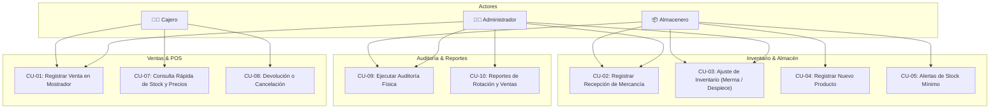

# Plan Integral de Desarrollo de Software (Fase de Inicio - UP)
## Sistema de Gestión de Inventario y Punto de Venta para Papelería Liz-Leo ("StockPapel Liz-Leo")

> **Metodología:** Proceso Unificado (Unified Process - UP / Craig Larman)  
> **Proyecto:** Sistema a la Medida de Automatización de Inventarios y Punto de Venta para Papelería Liz-Leo  
> **Entorno:** Papelería Comercial Liz-Leo (Artículos Escolares, Oficina, Mercería y Servicios de Mostrador)  

---

## Índice General

1. [Visión y Caso de Negocio](#1-visión-y-caso-de-negocio)
2. [Modelo de Casos de Uso](#2-modelo-de-casos-de-uso)
3. [Especificación Suplementaria (FURPS+)](#3-especificación-suplementaria-furps)
4. [Glosario y Diccionario de Datos](#4-glosario-y-diccionario-de-datos)
5. [Lista de Riesgos y Plan de Gestión de Riesgos](#5-lista-de-riesgos-y-plan-de-gestión-de-riesgos)
6. [Prototipos y Pruebas de Concepto (PoC)](#6-prototipos-y-pruebas-de-concepto-poc)
7. [Plan de Iteración (Elaboración 1 - E1)](#7-plan-de-iteración-elaboración-1---e1)
8. [Plan de Fases y Plan de Desarrollo de Software (SDP)](#8-plan-de-fases-y-plan-de-desarrollo-de-software-sdp)
9. [Caso de Desarrollo (Personalización de UP)](#9-caso-de-desarrollo-personalización-de-up)

---

## 1. Visión y Caso de Negocio

### 1.1. Resumen Ejecutivo
El sistema **StockPapel Liz-Leo** es una solución integral de software diseñada a la medida para modernizar y optimizar la administración de inventario, el control de existencias, las compras a mayoristas y la atención al cliente en el mostrador de la **Papelería Liz-Leo**. Su propósito es erradicar el descontrol de mercancías en anaqueles, prevenir quiebres de stock en temporadas clave de alta demanda ("Regreso a Clases") y minimizar las mermas por rotura de materiales o caducidad de pegamentos y tintas.

### 1.2. Declaración del Problema
- **El problema de:** Descontrol de existencias, lentitud en mostrador, falta de visibilidad del inventario real y compras ineficientes a proveedores.
- **Afecta a:** Dueño/Administrador de Papelería Liz-Leo, personal de mostrador/caja, encargado de almacén y clientes de la tienda.
- **Cuyo impacto es:** Ventas perdidas por desabasto, capital inmovilizado en artículos de baja rotación, 7-12% de pérdidas por merma/robo hormiga y filas en mostrador durante horas pico.
- **Una solución exitosa sería:** Un software especializado en el flujo operativo de Papelería Liz-Leo (códigos de barra, despiece caja/unidad, botones rápidos para servicios de copiado/enmicado/papel a granel y alertas preventivas de stock mínimo).

### 1.3. Viabilidad Financiera (ROI)
- **Inversión Inicial Estimada:** $84,000 MXN (desarrollo de software, hardware periférico POS y puesta en marcha).
- **Ahorro y Beneficio Anual Proyectado:** ~$108,000 MXN (recuperación de ventas perdidas, reducción de merma y ahorro sustancial de tiempo operativo).
- **Retorno de Inversión (ROI):** 28.6% en el primer año ($24,000 MXN de beneficio neto el primer año); recuperación de la inversión en **9 a 10 meses**.

---

## 2. Modelo de Casos de Uso

### 2.1. Actores
- **Cajero / Vendedor:** Operador de mostrador que realiza ventas rápidas, consultas de existencias y emisión de tickets.
- **Encargado de Almacén:** Gestiona el catálogo, recepción de mercancías de proveedores, despiece de cajas a piezas sueltas y mermas.
- **Administrador / Dueño:** Supervisa reportes financieros, define precios, gestiona usuarios y ejecuta auditorías físicas.

### 2.2. Diagrama de Casos de Uso

### 2.3. Caso de Uso Núcleo "Fully Dressed": CU-01 Registrar Venta en Mostrador
- **Actor:** Cajero.
- **Precondición:** Turno de caja abierto, escáner e impresora listos.
- **Garantía de Éxito:** Venta registrada, stock descontado atómicamente, dinero registrado en caja y ticket emitido.
- **Flujo Principal:**
  1. El cajero inicia la venta.
  2. Escanea código de barras del producto o teclea acceso rápido para artículos a granel/servicios (fotocopias, cartulinas).
  3. El sistema valida existencia, agrega ítem a la lista con precio y calcula subtotal.
  4. El sistema actualiza el Total general.
  5. El cliente entrega el dinero en efectivo; el sistema calcula el cambio.
  6. El cajero confirma la venta (`F12`).
  7. El sistema ejecuta transacción ACID: descuenta existencias en stock, registra movimiento en Kardex y guarda la venta.
  8. La impresora expulsa el ticket y el cajón portamonedas se abre.

---

## 3. Especificación Suplementaria (FURPS+)

- **Funcionalidad:** Seguridad basada en roles (RBAC: Cajero, Almacenero, Administrador), pista de auditoría inmutable en cada modificación de inventario, copias de seguridad automáticas diarias.
- **Usabilidad:** Navegación 100% por teclado ("mouse-less") para el cajero (`F1`-`F12`), alertas acústicas y visuales al escanear, tipografía grande y legible para totales y cambio.
- **Confiabilidad:** Consistencia transaccional ACID, tolerancia a cortes eléctricos repentinos mediante journaling de base de datos (WAL), disponibilidad 99.5%.
- **Rendimiento:** Búsqueda reactiva de productos < 250 ms en catálogo de hasta 15,000 SKUs, respuesta al escáner < 150 ms, cierre e impresión de ticket < 1.2 segundos.
- **Soportabilidad:** Arquitectura en 3 capas desacopladas, idioma español (México), moneda localizada en pesos mexicanos ($ MXN), exportación de catálogos y reportes a Excel/CSV.
- **Restricciones (+):** Compatibilidad con impresoras térmicas ESC/POS (58mm/80mm), lectores de barras USB HID, cajón RJ11 y SO Windows 10/11 en la estación de cobro de Papelería Liz-Leo.

---

## 4. Glosario y Diccionario de Datos

- **SKU:** Identificador alfanumérico único para cada producto del catálogo de Papelería Liz-Leo.
- **Despiece:** Conversión de paquetes/cajas cerradas a piezas individuales (ej. caja de 50 bolígrafos $\rightarrow$ 50 unidades sueltas).
- **Merma:** Pérdida por daño físico, rotura, solvente evaporado o caducidad.
- **Kardex:** Historial cronológico de entradas, salidas y saldos de cada artículo con valuación en pesos mexicanos ($ MXN).
- **Entidades Clave:** `Producto`, `Categoria`, `Proveedor`, `MovimientoKardex`, `Venta`, `DetalleVenta`, `Compra`, `AjusteInventario`, `Usuario`.

---

## 5. Lista de Riesgos y Gestión de Riesgos

| Riesgo | Tipo | Severidad | Mitigación Principal |
|---|---|:---:|---|
| **R-01: Cuello de botella al capturar catálogo inicial de Liz-Leo** | Negocio | Alta (9) | Carga masiva por Excel y precarga de base de datos maestra con los 1,000 productos escolares más vendidos en México. |
| **R-02: Incompatibilidad con periféricos POS** | Técnico | Moderada (6) | Prueba de concepto (PoC) temprana en Elaboración 1 con el hardware real de la estación de cobro de Papelería Liz-Leo. |
| **R-03: Resistencia al cambio del personal de Liz-Leo** | Negocio | Alta (7.5) | Interfaz amigable con atajos de teclado y acompañamiento en mostrador durante las primeras 72 horas de puesta en marcha. |
| **R-04: Pérdida de datos por apagones eléctricos** | Técnico | Alta (8) | Base de datos transaccional con journaling (WAL), respaldos diarios automatizados y uso de No-Break/UPS en mostrador. |
| **R-05: Desajuste por artículos sin código de barras** | Técnico | Moderada (6) | Botonera de accesos directos táctiles/teclado para servicios y papel a granel, más impresión de etiquetas con código de barras interno. |
| **R-06: Retraso hacia la temporada escolar de Liz-Leo** | Cronograma | Alta (8) | Timeboxing riguroso, MVP centrado en ventas y control de existencias, programando entregables antes del pico de Regreso a Clases. |

---

## 6. Prototipos y Pruebas de Concepto (PoC)

- **PoC Periféricos:** Se verificó la captura por lector USB emulando teclado y el disparo de comandos ESC/POS binarios hacia la impresora térmica y cajón de dinero con tiempos inferiores a 1 segundo.
- **PoC Despiece:** Se comprobó la integridad de transacciones relacionales donde la apertura de una caja de bolígrafos descuenta la caja y acredita 50 piezas sueltas con costo proporcional exacto en pesos ($ MXN).
- **Wireframes:** Pantalla de cobro rápida con botonera para servicios habituales de Papelería Liz-Leo (fotocopias, engargolados, enmicados, cartulinas) validada favorablemente por cajeros.

---

## 7. Plan de Iteración (Elaboración 1 - E1)

- **Duración:** 2 semanas (80 horas-hombre).
- **Objetivo:** Establecer la línea base arquitectónica y construir un incremento ejecutable que permita escanear un producto, procesar la venta en mostrador de Papelería Liz-Leo y descontar el inventario en una base de datos real.
- **Tareas Clave:**
  - Configuración del repositorio y esquema de base de datos (`productos`, `ventas`, `kardex`).
  - Servicios de catálogo y cálculo de transacciones ACID en moneda local ($ MXN).
  - Maquetado de pantalla de Punto de Venta con controlador de eventos de código de barras.
  - Pruebas de integración y validación directa con el dueño de Papelería Liz-Leo.

---

## 8. Plan de Fases y Plan de Desarrollo de Software (SDP)

- **Fase de Inicio (Inception):** 2 semanas (1 iteración) $\rightarrow$ Visión, alcance, riesgos y arquitectura preliminar.
- **Fase de Elaboración (Elaboration):** 4 semanas (2 iteraciones) $\rightarrow$ Mitigar riesgos críticos de hardware y concurrencia; estabilizar arquitectura ejecutable.
- **Fase de Construcción (Construction):** 6 semanas (3 iteraciones) $\rightarrow$ Desarrollo de despiece, compras, alertas de stock mínimo, reportes y perfiles.
- **Fase de Transición (Transition):** 3 semanas (2 iteraciones) $\rightarrow$ Despliegue en tienda de Papelería Liz-Leo, carga de su catálogo real, capacitación del personal y entrega.
- **Duración Total:** **15 semanas**.

---

## 9. Caso de Desarrollo (Personalización de UP)

Se adopta un **Proceso Unificado Ágil (Agile UP)** ajustado a las necesidades específicas de la **Papelería Liz-Leo**:
- Se omiten artefactos burocráticos pesados (Modelos de Análisis intermedios, diagramas BPMN corporativos).
- Se priorizan los artefactos que aportan valor directo: **Casos de Uso núcleo**, **FURPS+**, **Gestión de Riesgos** y **Entregables Ejecutables** cada 2 semanas.
- Se asegura la trazabilidad entre los requisitos de Papelería Liz-Leo y el código construido.

---

*Todos los artefactos individuales detallados se encuentran disponibles en la carpeta [`docs/`](docs/).*
