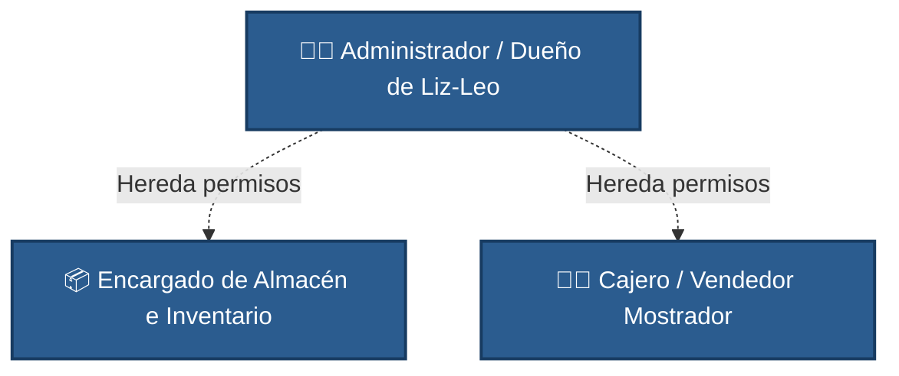
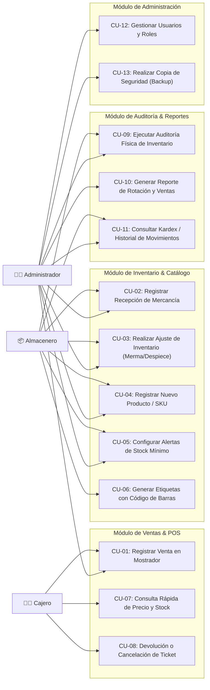

# Artefacto 02: Modelo de Casos de Uso
## Proyecto: Sistema de Gestión de Inventario y Punto de Venta para Papelería Liz-Leo ("StockPapel Liz-Leo")
**Metodología:** Proceso Unificado (UP) - Fase de Inicio

---

## 1. Introducción
El modelo de casos de uso captura los requisitos funcionales del sistema desde la perspectiva de los usuarios de la **Papelería Liz-Leo**. Siguiendo las directrices del Proceso Unificado para la Fase de Inicio, se identifican todos los casos de uso necesarios para la operación diaria de la papelería y se detallan en profundidad ("fully dressed") aquellos que representan el núcleo del negocio (ventas en mostrador, recepción de proveedores, despiece mayorista y auditorías físicas) y que conllevan los mayores riesgos operativos (~10-15%).

---

## 2. Actores del Sistema

- **Cajero / Vendedor de Mostrador:** Interactúa con el sistema en la estación de cobro de Papelería Liz-Leo para registrar ventas rápidas, consultar precios y existencias en tiempo real, procesar artículos sin código de barras (servicios y papelería a granel) y emitir tickets de compra.
- **Encargado de Almacén / Compras:** Responsable de dar de alta productos en el catálogo de Liz-Leo, registrar compras a distribuidores mayoristas, desempacar cajas para venta por piezas (despiece de bolígrafos, cuadernos, adhesivos), y reportar mermas o artículos dañados.
- **Administrador / Dueño de Liz-Leo:** Tiene control total del sistema. Define políticas de precios y márgenes de ganancia en moneda nacional ($ MXN), supervisa reportes financieros de caja, aprueba ajustes de inventario de alto valor, gestiona usuarios y ejecuta auditorías físicas.

---

## 3. Diagrama General de Casos de Uso

---

## 4. Catálogo Completo de Casos de Uso Identificados

| ID | Nombre del Caso de Uso | Actor(es) Principal(es) | Nivel de Prioridad | Estado de Análisis en Inicio |
|---|---|---|---|---|
| **CU-01** | Registrar Venta en Mostrador y Descarga de Stock | Cajero, Administrador | Crítica | **Completamente vestido (Fully Dressed)** |
| **CU-02** | Registrar Recepción de Mercancía de Proveedor | Almacenero, Administrador | Crítica | **Completamente vestido (Fully Dressed)** |
| **CU-03** | Realizar Ajuste de Inventario (Mermas / Despiece) | Almacenero, Administrador | Alta | **Completamente vestido (Fully Dressed)** |
| **CU-04** | Registrar Nuevo Producto en Catálogo (SKU) | Almacenero, Administrador | Media | Resumido |
| **CU-05** | Configurar Alertas de Stock Mínimo y Reorden | Almacenero, Administrador | Alta | Resumido |
| **CU-06** | Generar e Imprimir Etiquetas de Código de Barras | Almacenero | Media | Resumido |
| **CU-07** | Consulta Rápida de Precio, Ubicación y Stock | Cajero, Almacenero | Alta | Resumido |
| **CU-08** | Procesar Devolución o Cancelación de Venta | Cajero, Administrador | Media | Resumido |
| **CU-09** | Ejecutar Auditoría Física de Inventario | Almacenero, Administrador | Alta | **Completamente vestido (Fully Dressed)** |
| **CU-10** | Generar Reportes de Rotación y Pronóstico Escolar | Administrador | Alta | Resumido |
| **CU-11** | Consultar Kardex / Historial de Movimientos de Producto | Almacenero, Administrador | Alta | Resumido |
| **CU-12** | Administrar Usuarios y Asignación de Roles | Administrador | Media | Resumido |
| **CU-13** | Ejecutar Respaldo y Restauración de Base de Datos | Administrador | Alta | Resumido |

---

## 5. Casos de Uso Nucleares en Formato Completamente Vestido ("Fully Dressed")

### 5.1. CU-01: Registrar Venta en Mostrador y Descargar Inventario

- **Actor Principal:** Cajero / Vendedor de Mostrador.
- **Partes Interesadas e Intereses:**
  - *Cajero:* Desea un proceso ultrarrápido, fluido, sin retrasos, con soporte de teclado numérico y lector de barras.
  - *Cliente:* Desea agilidad en su compra, claridad en precios y ticket desglosado.
  - *Dueño/Administrador:* Desea que cada artículo vendido descuente inmediatamente su stock real, evitando inconsistencias y asegurando el registro de la ganancia marginal.
- **Precondiciones:**
  - El cajero ha iniciado sesión con su turno de caja activo.
  - El lector de códigos de barras y la impresora de tickets están conectados y operativos.
- **Garantías de Éxito (Postcondiciones):**
  - La venta queda registrada con fecha, hora, identificador único de ticket y cajero.
  - El stock de cada producto involucrado se descuenta atómicamente de la base de datos.
  - Si el stock de un producto cae por debajo de su umbral mínimo, se genera un evento de alerta interna.
  - Se genera el registro de ingreso en caja y se imprime el ticket físico (o se abre el cajón portamonedas).

#### Flujo Principal de Éxito (Camino Feliz):
1. El cliente presenta los artículos en mostrador o solicita un producto a granel/servicio (ej. fotocopias, cartulina, libreta).
2. El cajero inicia una nueva venta en el sistema (atajo `F1` o automático).
3. Por cada producto:
   - **Opción A (Con código):** El cajero escanea el código de barras (EAN-13/UPC) con el lector óptico.
   - **Opción B (Sin código / Servicio):** El cajero presiona tecla rápida o escribe las primeras letras del nombre (ej. "Cartulina blanca", "Fotocopia B/N") en la barra de búsqueda reactiva.
4. El sistema valida la existencia en inventario, agrega el ítem a la lista de venta con su descripción, precio unitario, cantidad solicitada y calcula el subtotal.
5. El sistema actualiza en pantalla el Total a Pagar, el Impuesto (IVA si aplica) y la cantidad total de artículos.
6. El cajero indica el método de pago (Efectivo por defecto, o tarjeta/transferencia).
7. Si el pago es en efectivo, el cajero digita el monto recibido del cliente; el sistema calcula y muestra en tipografía destacada el cambio a devolver.
8. El cajero confirma la venta (presiona `Enter` o tecla `F12`).
9. El sistema ejecuta una transacción ACID:
   - Descuenta las unidades correspondientes del stock del producto.
   - Almacena el detalle de la venta (id_venta, id_producto, cantidad, precio_costo_momento, precio_venta).
   - Registra el movimiento en el Kardex como tipo "SALIDA_VENTA".
10. El sistema envía el comando al puerto de la impresora térmica para emitir el ticket de compra y envía el pulso eléctrico al cajón de dinero para abrirlo.
11. La pantalla queda limpia y lista de inmediato para la siguiente venta.

#### Flujos Alternativos y Excepciones:
- **3a. El código de barras escaneado no existe en el catálogo:**
  - 1. El sistema emite un pitido de advertencia y muestra: *"Producto no registrado"*.
  - 2. El cajero puede buscar por nombre o solicitar a un supervisor autorización para registrar un ítem temporal o corregir el código.
- **4a. El stock disponible es menor a la cantidad solicitada (o está en cero):**
  - 1. El sistema despliega una alerta visual amarilla: *"Stock insuficiente en sistema (Disponible: X)"*.
  - 2. Si la política de la papelería lo permite (ej. si físicamente hay mercancía en tienda que aún no se capturó en sistema), se solicita confirmación al supervisor para venta con saldo negativo temporal o se rechaza la adición del ítem.
- **7a. El cliente no cuenta con el dinero suficiente o decide cancelar un ítem antes de pagar:**
  - 1. El cajero selecciona el producto y presiona `Supr` o `F4` para removerlo de la lista.
  - 2. El sistema recalcula totales inmediatamente sin afectar el inventario.
- **10a. Falla de conexión con la impresora térmica:**
  - 1. El sistema concluye exitosamente la transacción en base de datos.
  - 2. Muestra mensaje en pantalla: *"Venta completada #1024. Error al imprimir ticket. ¿Desea reintentar impresión?"*.

---

### 5.2. CU-02: Registrar Recepción de Mercancía de Proveedor

- **Actor Principal:** Encargado de Almacén / Compras.
- **Precondiciones:**
  - El usuario cuenta con la factura física o remisión de entrega del proveedor (ej. distribuidora de cuadernos, lápices o pegamentos).
- **Garantías de Éxito (Postcondiciones):**
  - El stock de los productos recibidos se incrementa en inventario.
  - Se actualiza el costo de adquisición (calculando el costo promedio ponderado si el precio varió).
  - Queda registrado el comprobante de recepción con proveedor, fecha y total para cuentas por pagar.

#### Flujo Principal de Éxito:
1. El encargado de almacén selecciona *Compras / Recepción de Mercancía*.
2. Selecciona o ingresa el nombre/RFC del proveedor y el número de factura/remisión.
3. Para cada artículo recibido:
   - Escanea el código de barras del producto o lo busca en el catálogo.
   - Digita la cantidad recibida y el costo unitario de compra de la factura.
   - Si el producto es recibido en empaque mayorista (ej. caja de 10 paquetes de hojas), el sistema permite indicar si entra como bulto mayorista o se desglosará.
4. El sistema compara el costo actual con el costo anterior: si cambió, avisa al usuario y calcula el nuevo Costo Promedio Ponderado.
5. El usuario revisa el monto total de la remisión en pantalla contra la factura física.
6. El usuario presiona *Confirmar Recepción*.
7. El sistema ejecuta la transacción:
   - Incrementa el stock de cada producto.
   - Registra el movimiento en el Kardex tipo "ENTRADA_COMPRA".
   - Actualiza el precio de costo del producto en el catálogo.
8. El sistema muestra mensaje de confirmación y permite imprimir el comprobante de ingreso a almacén.

---

### 5.3. CU-03: Realizar Ajuste de Inventario (Mermas y Despiece)

- **Actor Principal:** Encargado de Almacén / Administrador.
- **Precondiciones:** Se detecta mercancía dañada (ej. cartulinas rotas o manchadas, bolígrafos sin tinta, botes de silicón secos) o se requiere abrir una caja cerrada para surtir exhibidores de piezas sueltas.
- **Garantías de Éxito:** El inventario refleja el cambio exacto, indicando el motivo auditado y el usuario responsable.

#### Flujo Principal (Despiece - Conversión de Empaque a Piezas Sueltas):
1. El usuario selecciona *Ajuste de Inventario -> Conversión / Despiece*.
2. Escanea el código del producto padre (ej. "Caja de Lápiz HB x 12 unidades").
3. Selecciona la cantidad de cajas a abrir (ej. 1 caja).
4. El sistema identifica automáticamente el producto hijo vinculado ("Lápiz HB individual") con su factor de conversión (1 caja = 12 piezas).
5. El usuario confirma la operación.
6. El sistema decrementa 1 unidad del producto padre e incrementa 12 unidades del producto hijo, registrando el movimiento cruzado en el Kardex.

#### Flujo Alternativo (Registro de Merma / Daño):
- En el paso 2, el usuario selecciona el producto individual dañado.
- Selecciona el motivo del ajuste: *Rotura de material, Vencimiento/Secado, Defecto de fábrica, Robo hormiga*.
- Ingresa la cantidad a dar de baja y una nota descriptiva opcional.
- El sistema descuenta las existencias y registra el costo de la merma para cálculo contable de pérdidas del periodo.

---

### 5.4. CU-09: Ejecutar Auditoría Física de Inventario

- **Actor Principal:** Administrador / Dueño de Papelería Liz-Leo.
- **Precondiciones:** Se designa un pasillo o categoría de la papelería a inventariar (ej. "Pegamentos y Cintas", "Cuadernos y Libretas").
- **Garantías de Éxito:** Se genera un reporte comparativo entre el stock teórico del sistema y el conteo físico real, identificando discrepancias en unidades y valor monetario en pesos ($ MXN).

#### Flujo Principal:
1. El administrador inicia una *Sesión de Auditoría de Inventario*.
2. Selecciona si auditará toda la tienda de Liz-Leo o una categoría/estante específico.
3. El personal recorre los anaqueles escaneando cada artículo e ingresando la cantidad contada físicamente.
4. Al concluir el escaneo, el sistema genera la tabla comparativa:
   - `Producto | Stock Sistema | Conteo Físico | Diferencia (+/-) | Valor Pérdida ($ MXN)`
5. El administrador analiza los faltantes y sobrantes.
6. El administrador autoriza el cierre de auditoría y la aplicación de los ajustes automáticos para nivelar el sistema a la realidad física de Papelería Liz-Leo.
7. El sistema almacena la auditoría con folio, fecha y firmas digitales de los involucrados.
