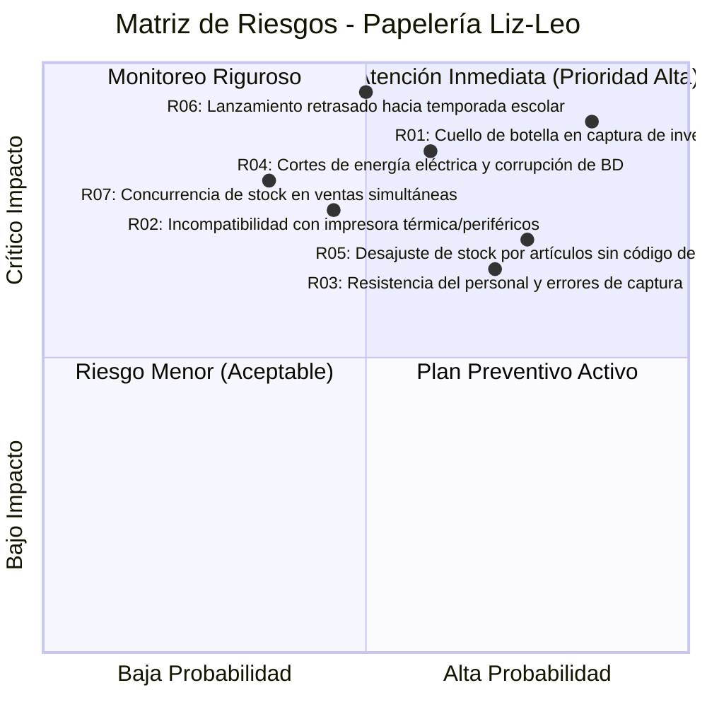

# Artefacto 05: Lista de Riesgos y Plan de Gestión de Riesgos
## Proyecto: Sistema de Gestión de Inventario y Punto de Venta para Papelería Liz-Leo ("StockPapel Liz-Leo")
**Metodología:** Proceso Unificado (UP) - Fase de Inicio

---

## 1. Introducción
El Proceso Unificado enfatiza el desarrollo iterativo conducido por riesgos y arquitectura (*Risk-Driven and Architecture-Centric*). Para la **Papelería Liz-Leo**, la identificación temprana de los riesgos operativos y técnicos permite priorizar los casos de uso más críticos en las primeras iteraciones de Elaboración, asegurando la continuidad del negocio y evitando sorpresas costosas al desplegar en tienda.

---

## 2. Matriz de Clasificación y Evaluación de Riesgos

La severidad de los riesgos se calcula combinando la Probabilidad ($P$) y el Impacto ($I$):
- **Probabilidad:** Baja (1), Media (2), Alta (3)
- **Impacto:** Bajo (1), Medio (2), Alto (3), Crítico (4)
- **Severidad = $P \times I$** $\rightarrow$ Baja (1-3), Moderada (4-6), Alta (8-9), Crítica (12)

---

## 3. Detalle de Riesgos y Estrategias de Mitigación

### 3.1. Riesgos de Negocio

#### R-01: Cuello de botella y retraso en la captura del inventario físico inicial de Liz-Leo
- **Descripción:** La Papelería Liz-Leo cuenta con más de 3,500 referencias en anaqueles sin un catálogo digital previo estandarizado. La captura manual uno a uno puede demorar semanas y retrasar la salida a producción.
- **Probabilidad:** Alta (3) | **Impacto:** Alto (3) | **Severidad:** 9 (Alta)
- **Estrategia de Mitigación (Preventiva):**
  1. Proveer una plantilla estandarizada en Excel para carga masiva vía importador CSV automático.
  2. Precargar una base de datos maestra con los 1,000 productos escolares y de oficina más comunes de México (marcas BIC, Scribe, Pritt, Paper Mate, Pelikan, Mae, etc.) con sus códigos EAN oficiales ya registrados.
  3. Estrategia de "Inventario Progresivo": iniciar operaciones en Liz-Leo con el "Top 20% de productos que generan el 80% de ventas" (Principio de Pareto) y capturar el resto conforme se reciba mercancía o se venda en mostrador.
- **Plan de Contingencia (Reactivo):** Habilitar una opción en punto de venta que permita al cajero registrar un artículo "Genérico / Rápido" en mostrador y guardarlo como "Pendiente de catalogar" para que el encargado complete los datos al cierre de turno.

#### R-03: Resistencia al cambio del personal de mostrador de Liz-Leo y errores operativos
- **Descripción:** El personal de mostrador acostumbra cobrar de memoria o calcular precios mentalmente. La introducción del sistema puede percibirse como una carga de trabajo o generar filas si la interfaz es poco ágil.
- **Probabilidad:** Media-Alta (2.5) | **Impacto:** Alto (3) | **Severidad:** 7.5 (Alta)
- **Estrategia de Mitigación:**
  1. Diseñar la pantalla de venta priorizando la velocidad operativa: menos de 3 clics o 100% navegable con atajos de teclado (`F1`, `F12`, `Enter`).
  2. Involucrar a los cajeros de Liz-Leo en las pruebas de prototipos (PoC) durante la fase de Elaboración.
  3. Sesiones prácticas de entrenamiento con simulación de situaciones reales de venta.
- **Plan de Contingencia:** Acompañamiento presencial en mostrador durante las primeras 72 horas del despliegue en tienda.

---

### 3.2. Riesgos Técnicos

#### R-02: Incompatibilidad con hardware periférico en el mostrador de Liz-Leo
- **Descripción:** Impresoras térmicas o lectores USB pueden presentar desajustes en conjuntos de caracteres de tickets o secuencias de corte y apertura de cajón RJ11.
- **Probabilidad:** Media (2) | **Impacto:** Alto (3) | **Severidad:** 6 (Moderada)
- **Estrategia de Mitigación:**
  1. Desarrollar una **Prueba de Concepto (PoC)** en la Iteración 1 de Elaboración con la impresora física real instalada en Papelería Liz-Leo.
  2. Implementar un módulo de impresión desacoplado que admita tanto comandos nativos ESC/POS binarios como impresión gráfica estándar a través del spooler de Windows.
- **Plan de Contingencia:** Disponer de una plantilla de ticket en PDF configurable que se envíe directamente al controlador de impresión de Windows si el comando ESC/POS nativo falla.

#### R-04: Cortes de energía eléctrica y pérdida de integridad en la base de datos
- **Descripción:** Variaciones o cortes en el suministro eléctrico local de Papelería Liz-Leo pueden apagar la PC de mostrador durante una transacción.
- **Probabilidad:** Media (2) | **Impacto:** Crítico (4) | **Severidad:** 8 (Alta)
- **Estrategia de Mitigación:**
  1. Utilizar un motor de base de datos transaccional con journaling/Write-Ahead Logging (WAL) que garantice recuperación automática sin corrupción de archivos.
  2. Requerir como prerrequisito de instalación una unidad de respaldo eléctrico ininterrumpido (UPS / No-Break) de mínimo 500VA para la terminal de mostrador.
  3. Copias de seguridad automáticas diarias al disco secundario o nube.
- **Plan de Contingencia:** Script automatizado de verificación de integridad y restauración con un solo clic desde el último respaldo validado.

#### R-05: Desajuste de stock por artículos pequeños sin código de barras (despiece y granel)
- **Descripción:** Productos como cartulinas, pliegos de papel crepé, foami, gomas individuales o servicios de fotocopias no poseen código de barras visible en la pieza física.
- **Probabilidad:** Alta (3) | **Impacto:** Medio (2) | **Severidad:** 6 (Moderada)
- **Estrategia de Mitigación:**
  1. Función de "Botonera Táctil / Atajos de Teclado" en la pantalla de cobro para los 20 artículos y servicios sin código más frecuentes de Papelería Liz-Leo.
  2. Generador e impresor integrado de etiquetas con códigos de barras internos (Code 128) para pegarlos en los exhibidores o cajoneras de piezas sueltas.
- **Plan de Contingencia:** Auditorías cíclicas semanales en estanterías de artículos sin código.

---

### 3.3. Riesgos de Cronograma y Recursos

#### R-06: Retraso en el calendario y colisión con la temporada alta escolar de Liz-Leo
- **Descripción:** Si el desarrollo se prolonga más de lo previsto y coincide con el pico de ventas de "Regreso a Clases" de Papelería Liz-Leo, resultará imposible implementar el software debido al alto flujo en mostrador.
- **Probabilidad:** Media (2) | **Impacto:** Crítico (4) | **Severidad:** 8 (Alta)
- **Estrategia de Mitigación:**
  1. Enfoque UP estricto: limitar el alcance del MVP (Mínimo Producto Viable) a los casos de uso esenciales (Ventas, Catálogo y Control Básico de Stock).
  2. Desplegar en modo de prueba controlada 4 semanas antes del inicio formal de la temporada alta escolar.
- **Plan de Contingencia:** Congelar nuevas funciones secundarias y enfocarse únicamente en estabilización y pruebas de carga antes de la fecha límite escolar.
