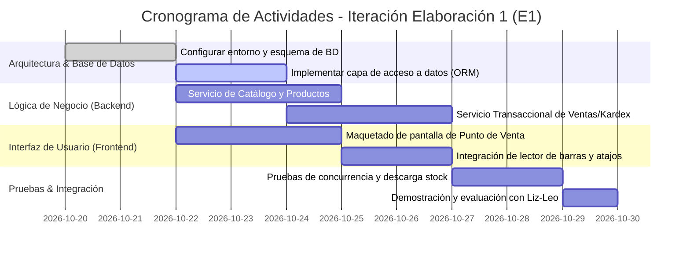

# Artefacto 07: Plan de Iteración (Elaboración 1 - E1)
## Proyecto: Sistema de Gestión de Inventario y Punto de Venta para Papelería Liz-Leo ("StockPapel Liz-Leo")
**Metodología:** Proceso Unificado (UP) - Fase de Inicio

---

## 1. Introducción y Enfoque de la Iteración
El Proceso Unificado prescribe que la **primera iteración de la fase de Elaboración (E1)** debe centrarse en construir un incremento de software **ejecutable** que aborde los riesgos arquitectónicos más severos y los casos de uso nucleares que definen el valor del sistema para la **Papelería Liz-Leo**.

- **Nombre de la Iteración:** Elaboración 1 (E1) - *"Línea Base de la Arquitectura y Núcleo de Ventas/Stock de Papelería Liz-Leo"*.
- **Duración Estimada:** 2 semanas (10 días hábiles de trabajo).
- **Meta Principal:** Construir la infraestructura arquitectónica transversal y un prototipo ejecutable con base de datos real donde sea posible escanear un producto del catálogo de Liz-Leo, completar una venta en mostrador con cobro en pesos ($ MXN) y verificar el descuento atómico de existencias en el Kardex.

---

## 2. Casos de Uso y Funcionalidades Incluidas en la Iteración E1

| Caso de Uso / Requisito | Alcance Específico para la Iteración E1 |
|---|---|
| **CU-01: Registrar Venta en Mostrador** | Flujo principal completo con lectura de código de barras USB, adición a carrito de venta, cálculo de total y cambio en pesos mexicanos ($ MXN) y decremento de stock en base de datos. (Excluye devoluciones y descuentos avanzados). |
| **CU-02: Registrar Recepción de Mercancía** | Ingreso básico de existencias de un producto existente para aumentar el stock disponible en almacén de Liz-Leo con costo en MXN. |
| **CU-04: Registrar Producto (Básico)** | CRUD esencial de productos de papelería (SKU, código de barras, nombre, precio costo en MXN, precio venta en MXN, stock inicial y stock mínimo). |
| **Línea Base de Arquitectura (NF)** | Configuración del motor de base de datos transaccional, esquema de tablas iniciales, logging de transacciones y diseño de la interfaz base para mostrador. |

---

## 3. Desglose Detallado de Tareas (WBS de la Iteración E1)

### Tabla de Asignación y Estimación de Esfuerzo

| ID Tarea | Descripción de la Tarea | Rol Responsable | Esfuerzo Estimado |
|---|---|---|---|
| **T-01** | Inicializar repositorio de código, dependencias y estructura de capas arquitectónicas. | Arquitecto / Lead Dev | 6 horas |
| **T-02** | Diseñar y ejecutar scripts DDL de la base de datos (tablas: `productos`, `ventas`, `detalles_venta`, `kardex`). | Desarrollador Backend | 10 horas |
| **T-03** | Implementar endpoints / servicios CRUD para gestión del catálogo de productos y validación de códigos EAN en MXN. | Desarrollador Backend | 12 horas |
| **T-04** | Desarrollar lógica transaccional de venta con descuento atómico de stock y verificación de niveles mínimos. | Desarrollador Backend | 14 horas |
| **T-05** | Diseñar y codificar la interfaz de usuario del Punto de Venta de Liz-Leo (grilla de productos, totales en MXN, modal de cobro). | Desarrollador Frontend | 16 horas |
| **T-06** | Integrar el controlador de eventos para escaneo rápido de códigos de barras USB sin pérdida de foco. | Desarrollador Frontend | 8 horas |
| **T-07** | Desarrollar suite de pruebas unitarias y de integración para transacciones de venta simultáneas. | Ingeniero de QA / Pruebas | 10 horas |
| **T-08** | Desplegar build ejecutable en la PC de prueba de Papelería Liz-Leo y realizar sesión de feedback con el dueño. | Todo el equipo | 4 horas |
| **TOTAL** | **Esfuerzo total estimado de la Iteración E1** | | **80 horas-hombre** |

---

## 4. Riesgos a Retirar o Mitigar en esta Iteración
- **R-02 (Hardware Periférico de Liz-Leo):** Se verificará en el hardware real del mostrador que los códigos leídos por el escáner se procesen sin retrasos y sin alterar la navegación del cajero.
- **R-07 (Concurrencia de Stock):** Se someterá el motor de base de datos a pruebas de concurrencia simulando ventas rápidas para garantizar que ninguna venta sobrevenda el stock ni corrompa el saldo.

---

## 5. Criterios de Aceptación y Evaluación de la Iteración E1
La Iteración E1 se considerará exitosa únicamente si se cumplen los siguientes criterios verificables:
1. **Ejecutable funcional:** Existe una versión ejecutable que arranca sin errores en Windows 10/11 en la tienda de Papelería Liz-Leo.
2. **Ciclo de venta completo:** Es posible escanear 3 artículos con código de barras, buscar 1 artículo sin código por nombre, registrar el pago en efectivo en pesos mexicanos ($ MXN), calcular el cambio exacto en MXN y confirmar la transacción.
3. **Persistencia y verificación de stock:**
   - La tabla `kardex` registra inmediatamente los registros de salida correspondientes con valuación en MXN.
   - El stock de los artículos vendidos disminuye en la cantidad exacta.
4. **Respuesta en tiempo:** El tiempo entre el escaneo del código y la visualización del producto en pantalla es inferior a 200 ms.
5. **Aprobación de la parte interesada:** El dueño de la Papelería Liz-Leo opera la pantalla de venta durante una sesión de demostración y firma la aceptación de la línea base arquitectónica.
