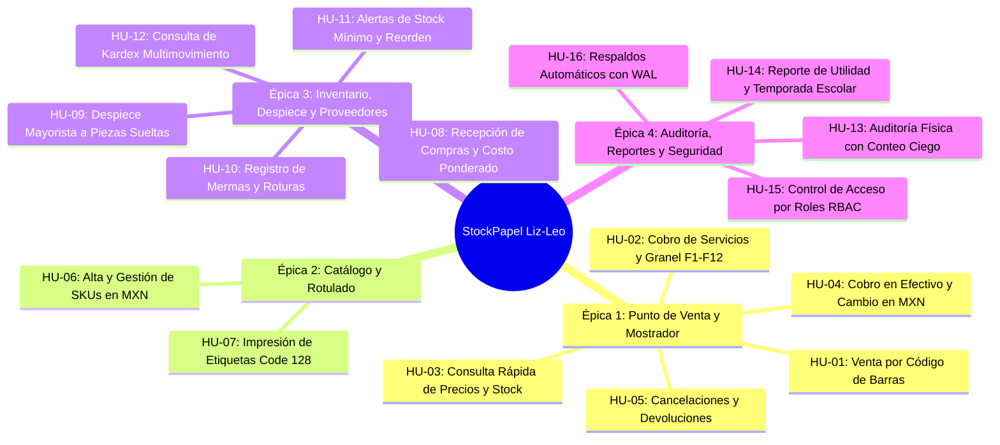

# Artefacto 10: Backlog de Historias de Usuario (User Stories)
## Proyecto: Sistema de Gestión de Inventario y Punto de Venta para Papelería Liz-Leo ("StockPapel Liz-Leo")
**Metodología:** Proceso Unificado Ágil (Agile UP) / Scrum Backlog  
**Moneda Oficial:** Pesos Mexicanos ($ MXN)

---

## 1. Introducción y Enfoque Ágil
Este documento complementa el **[Modelo de Casos de Uso (Artefacto 02)](file:///c:/Users/remed/OneDrive/Documents/ProyectoAyDA/docs/02_Modelo_de_Casos_de_Uso.md)** transformando los requerimientos funcionales y no funcionales en un **Product Backlog de Historias de Usuario**. 

Cada historia de usuario está redactada bajo el formato estándar de la industria (*Role-Feature-Reason*), cumple con los criterios de calidad **INVEST** (Independiente, Negociable, Valiosa, Estimable, Pequeña y Testeable), incluye sus **Criterios de Aceptación en formato BDD (Given-When-Then)** y cuenta con prioridad **MoSCoW** y estimación en **Story Points (SP)** mediante la escala de Fibonacci (1, 2, 3, 5, 8).

---

## 2. Mapa de Épicas (Epic Hierarchy)



---

## 3. Matriz Resumen del Product Backlog

| ID | Título de la Historia de Usuario | Épica | Actor Principal | Prioridad MoSCoW | Caso de Uso | Story Points |
|---|---|---|---|:---:|:---:|:---:|
| **HU-01** | Escaneo ágil de artículos con código de barras en mostrador | POS & Mostrador | Cajero | **Must Have** | CU-01 | 5 |
| **HU-02** | Venta de servicios y artículos a granel mediante atajos de teclado | POS & Mostrador | Cajero | **Must Have** | CU-01 | 3 |
| **HU-03** | Consulta ultrarrápida de existencias y precios en pesos mexicanos | POS & Mostrador | Cajero | **Must Have** | CU-07 | 2 |
| **HU-04** | Liquidación de ticket en efectivo, cálculo de cambio y apertura de cajón | POS & Mostrador | Cajero | **Must Have** | CU-01 | 5 |
| **HU-05** | Cancelación de artículos y reversión de tickets autorizada | POS & Mostrador | Cajero / Admin | **Should Have** | CU-08 | 3 |
| **HU-06** | Registro y mantenimiento de catálogo de productos en $ MXN | Catálogo | Almacenero | **Must Have** | CU-04 | 5 |
| **HU-07** | Generación e impresión de etiquetas con código de barras interno | Catálogo | Almacenero | **Could Have** | CU-06 | 3 |
| **HU-08** | Recepción de mercancía mayorista y actualización de costo promedio | Inventario & Compras | Almacenero | **Must Have** | CU-02 | 8 |
| **HU-09** | Despiece y fraccionamiento automático de bultos a piezas sueltas | Inventario & Compras | Almacenero | **Must Have** | CU-03 | 5 |
| **HU-10** | Registro clasificado de mermas, caducidades y daños de mostrador | Inventario & Compras | Almacenero | **Must Have** | CU-03 | 3 |
| **HU-11** | Monitor visual de stock de seguridad y sugerencia de compra escolar | Inventario & Compras | Admin / Almacén | **Should Have** | CU-05 | 5 |
| **HU-12** | Auditoría y trazabilidad cronológica en Kardex valorizado | Inventario & Compras | Admin / Almacén | **Must Have** | CU-11 | 5 |
| **HU-13** | Auditoría física de inventario con conteo ciego y desbalance en MXN | Auditoría & Reportes | Dueño / Admin | **Should Have** | CU-09 | 8 |
| **HU-14** | Reporte ejecutivo de ventas, utilidad bruta y rotación por temporada | Auditoría & Reportes | Dueño / Admin | **Should Have** | CU-10 | 5 |
| **HU-15** | Control de perfiles de usuario (RBAC) y bitácora de auditoría | Administración | Dueño / Admin | **Must Have** | CU-12 | 3 |
| **HU-16** | Respaldo y restauración automatizada tolerante a cortes eléctricos | Administración | Dueño / Admin | **Must Have** | CU-13 | 5 |
| **TOTAL** | **16 Historias de Usuario** | | | | | **73 SP** |

---

## 4. Detalle de Historias de Usuario por Épica

### Épica 1: Punto de Venta (POS) y Atención en Mostrador

#### HU-01: Escaneo ágil de artículos con código de barras en mostrador
- **Como** Cajero de la Papelería Liz-Leo,
- **Quiero** escanear los códigos de barras de los útiles escolares (libretas, bolígrafos, pegamentos) con el lector óptico USB,
- **Para** agregar los artículos al carrito de venta de forma instantánea sin tener que buscarlos manualmente ni usar el mouse.
- **Prioridad:** Must Have | **Estimación:** 5 Story Points | **Caso de Uso:** CU-01
- **Criterios de Aceptación (Gherkin):**
  - **Escenario 1: Código de barras existente en catálogo**
    - *Dado* que el cajero tiene una venta activa y el foco está en la interfaz de cobro,
    - *Cuando* pasa un producto por el lector óptico USB (ej. Libreta Scribe EAN-13),
    - *Entonces* el sistema agrega el producto en menos de 150 ms a la lista de venta con su descripción, precio unitario en $ MXN, cantidad 1 y subtotal, emitiendo un sonido confirmatorio breve.
  - **Escenario 2: Escaneo consecutivo del mismo artículo**
    - *Dado* que un artículo ya se encuentra listado en la pantalla de cobro,
    - *Cuando* el cajero escanea nuevamente el mismo código de barras,
    - *Entonces* el sistema incrementa la cantidad en +1 y recalcula el subtotal de la línea sin duplicar filas.
  - **Escenario 3: Código no reconocido**
    - *Dado* que se escanea un código no registrado en la base de datos de Liz-Leo,
    - *Cuando* el escáner envía los caracteres,
    - *Entonces* el sistema emite una alerta sonora grave y despliega un mensaje modal *"Código no registrado en catálogo"* con opción rápida de reintento o búsqueda manual.

---

#### HU-02: Venta de servicios y artículos a granel mediante atajos de teclado
- **Como** Cajero de mostrador de Papelería Liz-Leo,
- **Quiero** cobrar servicios (fotocopias, enmicados, impresiones) y artículos sin código (cartulinas, pliegos, papel por metro) usando teclas de función rápida (`F3` a `F8`),
- **Para** despachar a los clientes en menos de 50 segundos sin perder tiempo buscando códigos inexistentes.
- **Prioridad:** Must Have | **Estimación:** 3 Story Points | **Caso de Uso:** CU-01
- **Criterios de Aceptación:**
  - **Criterio 1:** Las teclas `F3` a `F8` están mapeadas a los servicios más frecuentes (F3: Fotocopia B/N $1.00 MXN, F4: Fotocopia Color $4.00 MXN, F5: Cartulina Blanca $6.00 MXN, F6: Papel Crepé $7.50 MXN, F7: Enmicado Carta $15.00 MXN, F8: Paquete Hojas Blancas x100).
  - **Criterio 2:** Al presionar la tecla rápida, el ítem se agrega directamente a la lista de venta. Si el cajero digita un multiplicador previo (ej. `10` + `F3`), se agregan 10 copias con total de $10.00 MXN.
  - **Criterio 3:** Los servicios tangibles no descuentan inventario unitario, pero sí suman al corte de caja en $ MXN.

---

#### HU-03: Consulta ultrarrápida de existencias y precios en pesos mexicanos
- **Como** Cajero o Vendedor de mostrador,
- **Quiero** presionar una tecla (`F2`) y escribir parte del nombre de un producto para ver de inmediato su precio y cantidad disponible en tienda,
- **Para** responder preguntas de los clientes en el mostrador sin cancelar la venta en curso.
- **Prioridad:** Must Have | **Estimación:** 2 Story Points | **Caso de Uso:** CU-07
- **Criterios de Aceptación:**
  - **Criterio 1:** Al pulsar `F2`, se abre una ventana modal de búsqueda reactiva sin borrar los artículos del cliente actual.
  - **Criterio 2:** La búsqueda por coincidencias (ej. "pegam pritt") responde en menos de 250 ms sobre todo el catálogo de Liz-Leo.
  - **Criterio 3:** La grilla muestra: `Nombre`, `Categoría`, `Stock Actual` (con semáforo verde si hay stock o rojo si está agotado), `Precio de Venta ($ MXN)` y `Ubicación/Pasillo`.
  - **Criterio 4:** Al pulsar `Enter` sobre un ítem seleccionado, se transfiere al carrito de cobro si se desea; al pulsar `Esc`, se cierra la consulta.

---

#### HU-04: Liquidación de ticket en efectivo, cálculo de cambio y apertura de cajón
- **Como** Cajero de Papelería Liz-Leo,
- **Quiero** finalizar la venta ingresando el importe recibido en pesos mexicanos (`$ MXN`), ver el cambio a devolver en pantalla gigante y que el ticket se imprima automáticamente abriendo el cajón de dinero,
- **Para** evitar errores de cálculo mental y agilizar el cobro durante horas pico.
- **Prioridad:** Must Have | **Estimación:** 5 Story Points | **Caso de Uso:** CU-01
- **Criterios de Aceptación:**
  - **Criterio 1:** Al presionar `F12`, se abre el diálogo de cobro mostrando el `TOTAL A PAGAR` en tipografía legible mínima de 28px.
  - **Criterio 2:** El cajero ingresa el monto recibido (ej. $200.00 MXN para un total de $145.00 MXN); el sistema calcula automáticamente `CAMBIO: $55.00 MXN`.
  - **Criterio 3:** Si el monto ingresado es inferior al total, el sistema deshabilita la confirmación y alerta del faltante.
  - **Criterio 4:** Al confirmar (`Enter`), se ejecuta una transacción atómica que:
    1. Descuenta las existencias en la base de datos local.
    2. Registra los movimientos en el Kardex.
    3. Envía el comando ESC/POS para abrir el cajón RJ11 y cortar el ticket térmico en menos de 1.2 segundos.

---

#### HU-05: Cancelación de artículos y reversión de tickets autorizada
- **Como** Administrador o Supervisor de Papelería Liz-Leo,
- **Quiero** autorizar la cancelación de un ítem erróneo o la anulación de un ticket emitido mediante clave de seguridad,
- **Para** evitar robos o manipulaciones no autorizadas en el corte de caja del mostrador.
- **Prioridad:** Should Have | **Estimación:** 3 Story Points | **Caso de Uso:** CU-08
- **Criterios de Aceptación:**
  - **Criterio 1:** Si un cajero intenta anular un ticket cerrado o eliminar un renglón superior a $100.00 MXN, el sistema solicita usuario y contraseña de Administrador.
  - **Criterio 2:** Al anularse una venta, las unidades vendidas regresan de manera automática al stock disponible del almacén.
  - **Criterio 3:** El sistema genera un registro de auditoría con la fecha, el folio anulado, el monto devuelto en $ MXN y el motivo especificado.

---

### Épica 2: Gestión de Catálogo y Código de Barras

#### HU-06: Registro y mantenimiento de catálogo de productos en $ MXN
- **Como** Encargado de Almacén o Administrador de Liz-Leo,
- **Quiero** dar de alta, editar y categorizar artículos escolares y de oficina asignando precios de costo, precios de venta y umbrales de stock mínimo en moneda nacional,
- **Para** tener el catálogo de más de 3,500 productos perfectamente identificado y valorizado.
- **Prioridad:** Must Have | **Estimación:** 5 Story Points | **Caso de Uso:** CU-04
- **Criterios de Aceptación:**
  - **Criterio 1:** El formulario valida campos obligatorios: `SKU`, `Nombre descriptivo`, `Categoría`, `Precio Costo ($ MXN)`, `Precio Venta ($ MXN)`, `Stock Mínimo` y `Unidad de Medida`.
  - **Criterio 2:** El sistema no permite guardar precios de venta menores al precio de costo y calcula automáticamente el `% de Margen de Utilidad`.
  - **Criterio 3:** Permite importar masivamente catálogos iniciales mediante archivo CSV/Excel con las plantillas predefinidas de papelería.

---

#### HU-07: Generación e impresión de etiquetas con código de barras interno
- **Como** Encargado de Almacén,
- **Quiero** generar etiquetas adhesivas con código de barras formato Code 128 para productos que se venden sueltos o que carecen de empaque original,
- **Para** colocarlas en los separadores de anaquel y permitir su escaneo en mostrador.
- **Prioridad:** Could Have | **Estimación:** 3 Story Points | **Caso de Uso:** CU-06
- **Criterios de Aceptación:**
  - **Criterio 1:** El usuario selecciona el producto y la cantidad de etiquetas a imprimir.
  - **Criterio 2:** La etiqueta incluye: Nombre de Papelería Liz-Leo, descripción del producto, precio de venta en $ MXN y el código de barras legible por el escáner del mostrador.
  - **Criterio 3:** Compatible con formatos de papel térmico estándar de 58 mm / etiquetas adhesivas comerciales.

---

### Épica 3: Control de Inventario, Despiece y Proveedores

#### HU-08: Recepción de mercancía mayorista y actualización de costo promedio
- **Como** Encargado de Almacén de Papelería Liz-Leo,
- **Quiero** registrar la entrada de pedidos surtidos por proveedores capturando la factura o remisión,
- **Para** actualizar el stock físico disponible y recalcular el Costo Promedio Ponderado (CPP) en $ MXN.
- **Prioridad:** Must Have | **Estimación:** 8 Story Points | **Caso de Uso:** CU-02
- **Criterios de Aceptación:**
  - **Criterio 1:** Permite seleccionar o dar de alta al proveedor (ej. Scribe, BIC México, Mae).
  - **Criterio 2:** Al ingresar las piezas y el nuevo costo de factura, si el precio varió respecto a la última compra, el sistema recalcula el CPP mediante la fórmula:
    $$\text{Nuevo CPP} = \frac{(\text{Stock Actual} \times \text{CPP Anterior}) + (\text{Cant. Recibida} \times \text{Costo Factura})}{\text{Stock Actual} + \text{Cant. Recibida}}$$
  - **Criterio 3:** Se genera el movimiento tipo `ENTRADA_COMPRA` en el Kardex y se actualizan las existencias en tiempo real.

---

#### HU-09: Despiece y fraccionamiento automático de bultos a piezas sueltas
- **Como** Encargado de Almacén o Cajero de Liz-Leo,
- **Quiero** registrar la apertura de un paquete mayorista (ej. caja de 50 bolígrafos BIC o resma de 500 hojas bond),
- **Para** que el sistema reste la caja del stock mayorista y acredite automáticamente las unidades sueltas con costo unitario exacto en MXN.
- **Prioridad:** Must Have | **Estimación:** 5 Story Points | **Caso de Uso:** CU-03
- **Criterios de Aceptación:**
  - **Criterio 1:** En la pantalla de despiece se escanea la caja padre (ej. "Caja BIC Negro x50").
  - **Criterio 2:** El sistema reconoce el producto hijo vinculado ("Bolígrafo BIC Negro Suelto") y su factor de conversión (1 caja = 50 piezas).
  - **Criterio 3:** Al confirmar la apertura de 1 caja:
    - Se resta 1 unidad al producto padre.
    - Se suman 50 unidades al producto hijo.
    - El costo unitario de la pieza suelta se hereda proporcionalmente: $\text{Costo Pieza} = \frac{\text{Costo Caja}}{50}$.
  - **Criterio 4:** La operación es atómica en la base de datos (ambos inventarios se actualizan juntos o ninguno).

---

#### HU-10: Registro clasificado de mermas, caducidades y daños de mostrador
- **Como** Encargado de Almacén o Administrador,
- **Quiero** registrar bajas de mercancía por roturas (cartulinas dobladas), secado de tintas/pegamentos o robo hormiga indicando el motivo,
- **Para** mantener las existencias teóricas cuadradas con las físicas y cuantificar las pérdidas monetarias en pesos ($ MXN).
- **Prioridad:** Must Have | **Estimación:** 3 Story Points | **Caso de Uso:** CU-03
- **Criterios de Aceptación:**
  - **Criterio 1:** Se selecciona el producto dañado y el catálogo de motivos: `Rotura física`, `Secado/Vencimiento`, `Defecto de proveedor` o `Faltante no identificado (Robo)`.
  - **Criterio 2:** Se descuentan las unidades y se calcula la pérdida monetaria total: $\text{Pérdida} = \text{Cantidad} \times \text{Precio de Costo ($ MXN)}$.
  - **Criterio 3:** El movimiento queda asentado en el Kardex bajo el tipo `AJUSTE_MERMA` asociando la fecha y el usuario que lo reportó.

---

#### HU-11: Alertas visuales automáticas de stock mínimo y sugerencia de compra escolar
- **Como** Dueño de la Papelería Liz-Leo,
- **Quiero** recibir alertas en pantalla cuando un artículo escolar alcance su stock de seguridad y contar con un generador automático de pedido sugerido,
- **Para** no quedarme sin mercancía clave durante el pico del "Regreso a Clases".
- **Prioridad:** Should Have | **Estimación:** 5 Story Points | **Caso de Uso:** CU-05
- **Criterios de Aceptación:**
  - **Criterio 1:** El dashboard principal muestra un semáforo de existencias (Verde: Óptimo, Amarillo: Próximo a reorden, Rojo: Por debajo de stock mínimo).
  - **Criterio 2:** Botón de un clic para *"Generar Sugerencia de Compra"*, que lista los artículos en rojo calculando la cantidad necesaria para cubrir 30 días de venta promedio.
  - **Criterio 3:** Exportación del reporte de compra sugerido a Excel (.xlsx) con nombre del proveedor y costo estimado en pesos mexicanos.

---

#### HU-12: Consulta de Kardex y trazabilidad de movimientos valorizados
- **Como** Dueño o Administrador de Liz-Leo,
- **Quiero** consultar el historial cronológico completo de cualquier SKU de la tienda,
- **Para** verificar quién dio de alta mercancía, cuándo se vendió, qué ajustes hubo y asegurar que no haya fugas de inventario.
- **Prioridad:** Must Have | **Estimación:** 5 Story Points | **Caso de Uso:** CU-11
- **Criterios de Aceptación:**
  - **Criterio 1:** El reporte del Kardex es inmutable y muestra: `Fecha/Hora`, `Tipo de Movimiento`, `Folio Referencia`, `Usuario`, `Entrada/Salida`, `Saldo Resultante` y `Valuación en $ MXN`.
  - **Criterio 2:** Filtros por rango de fechas, por categoría y por tipo de movimiento (Ventas, Compras, Mermas).

---

### Épica 4: Auditoría, Reportes Financieros y Seguridad

#### HU-13: Auditoría física de inventario con conteo ciego y balance de pérdidas en MXN
- **Como** Dueño de la Papelería Liz-Leo,
- **Quiero** realizar auditorías físicas periódicas por anaquel o categoría mediante conteo ciego con lector de código de barras,
- **Para** comparar las piezas contadas contra el sistema, detectar discrepancias y nivelar el stock aplicando las pérdidas en dinero ($ MXN).
- **Prioridad:** Should Have | **Estimación:** 8 Story Points | **Caso de Uso:** CU-09
- **Criterios de Aceptación:**
  - **Criterio 1:** En modo de conteo ciego, la pantalla no muestra la existencia registrada en el sistema al cajero/auditor mientras escanea para evitar sesgos.
  - **Criterio 2:** Al finalizar el conteo, solo el Administrador puede ver el informe comparativo: `Stock Teórico | Conteo Real | Diferencia (+/-) | Impacto Financiero en $ MXN`.
  - **Criterio 3:** Al autorizar el cierre, el sistema ajusta automáticamente el inventario a la cifra física real y emite el folio de auditoría firmado.

---

#### HU-14: Reporte ejecutivo de ventas, utilidad bruta y rotación por temporada
- **Como** Dueño de la Papelería Liz-Leo,
- **Quiero** consultar reportes diarios, semanales y mensuales de ingresos, utilidad bruta en pesos y lista de los 20 artículos más vendidos,
- **Para** tomar decisiones estratégicas de compra e inversión de capital de trabajo.
- **Prioridad:** Should Have | **Estimación:** 5 Story Points | **Caso de Uso:** CU-10
- **Criterios de Aceptación:**
  - **Criterio 1:** Desglose claro de ingresos brutos en $ MXN, costo de mercancía vendida (COGS) y **utilidad neta de operación**.
  - **Criterio 2:** Clasificación de productos según regla de Pareto (Top 20% de artículos que generan el 80% de ventas).
  - **Criterio 3:** Gráfica comparativa de ventas entre semanas ordinarias y semanas de temporada escolar.

---

#### HU-15: Control de acceso basado en roles (RBAC) y bitácora de seguridad
- **Como** Administrador de Papelería Liz-Leo,
- **Quiero** restringir los permisos del sistema asignando perfiles de Cajero, Almacenero y Administrador,
- **Para** proteger la información confidencial de costos, márgenes de ganancia y evitar modificaciones no autorizadas en inventarios.
- **Prioridad:** Must Have | **Estimación:** 3 Story Points | **Caso de Uso:** CU-12
- **Criterios de Aceptación:**
  - **Criterio 1:** Los usuarios inician sesión con identificador y contraseña cifrada con bcrypt/Argon2.
  - **Criterio 2:** El rol `Cajero` únicamente tiene acceso a venta en mostrador y consulta de precios; no puede ver costos de compra, márgenes ni reportes gerenciales.
  - **Criterio 3:** Toda acción crítica (cambio de precios, eliminación de registros, anulaciones) queda registrada en la bitácora del sistema con usuario y hora.

---

#### HU-16: Respaldo y restauración automatizada tolerante a cortes eléctricos
- **Como** Dueño de Papelería Liz-Leo,
- **Quiero** que el sistema realice copias de seguridad automáticas diarias y soporte apagones repentinos sin dañar la base de datos,
- **Para** no perder registros de ventas ni información contable valiosa ante fallas de energía en la tienda.
- **Prioridad:** Must Have | **Estimación:** 5 Story Points | **Caso de Uso:** CU-13
- **Criterios de Aceptación:**
  - **Criterio 1:** La base de datos opera con journaling transaccional (WAL - Write-Ahead Logging) para garantizar recuperación a cero fallos tras un corte de luz.
  - **Criterio 2:** Generación automática diaria de respaldo comprimido y cifrado al momento de cerrar la jornada en mostrador.
  - **Criterio 3:** Opción de exportar el archivo de respaldo a memoria USB externa o carpeta sincronizada en la nube con un solo clic.

---

## 5. Mapeo de Historias de Usuario hacia las Fases de UP

```mermaid
gantt
    title Plan de Implementación de Historias de Usuario por Fases UP
    dateFormat  YYYY-MM-DD
    section Fase Elaboración (Semanas 3 a 6)
    HU-01: Venta con lector de barras          :done, e1_1, 2026-10-16, 2w
    HU-02: Atajos F1-F12 servicios y granel    :done, e1_2, after e1_1, 1w
    HU-04: Cobro en efectivo y cambio en MXN    :done, e1_3, after e1_1, 2w
    HU-06: Catálogo de productos en MXN        :done, e1_4, 2026-10-16, 2w
    HU-08: Recepción de mercancía mayorista    :active, e2_1, after e1_3, 2w
    HU-09: Despiece caja a piezas sueltas      :active, e2_2, after e1_3, 2w
    section Fase Construcción (Semanas 7 a 12)
    HU-03: Consulta rápida de precios y stock  :c1_1, after e2_1, 1w
    HU-05: Cancelaciones y reversión tickets   :c1_2, after c1_1, 1w
    HU-10: Registro clasificado de mermas      :c1_3, after c1_1, 1w
    HU-12: Kardex inmutable valorizado         :c1_4, after c1_3, 2w
    HU-11: Alertas y compras temporada escolar :c2_1, after c1_4, 2w
    HU-13: Auditoría física con conteo ciego   :c2_2, after c2_1, 2w
    HU-14: Reporte de utilidades y ventas      :c2_3, after c2_1, 2w
    HU-15: Perfiles RBAC y bitácora            :c3_1, after c2_3, 1w
    HU-16: Respaldos automáticos con WAL       :c3_2, after c3_1, 1w
    HU-07: Impresión de etiquetas internas     :c3_3, after c3_1, 1w
    section Fase Transición (Semanas 13 a 15)
    Validación en tienda física de Liz-Leo     :t1, after c3_2, 3w
```

---

## 6. Definición de Hecho (Definition of Done - DoD)

Una Historia de Usuario se da por **COMPLETADA (Done)** en el ciclo de vida del proyecto únicamente cuando:
1. El código fuente está escrito, formateado y libre de advertencias graves de compilación/linting.
2. Cumple al 100% con los criterios de aceptación verificados con datos reales de la Papelería Liz-Leo.
3. Todas las operaciones monetarias se procesan y despliegan en **pesos mexicanos ($ MXN)**.
4. Ha sido probada con los periféricos reales (lector de código de barras USB o impresora térmica ESC/POS cuando aplique).
5. Las transacciones que alteran existencias se reflejan atómicamente en el Kardex.
6. Ha sido demostrada y aprobada por el dueño de la **Papelería Liz-Leo**.
